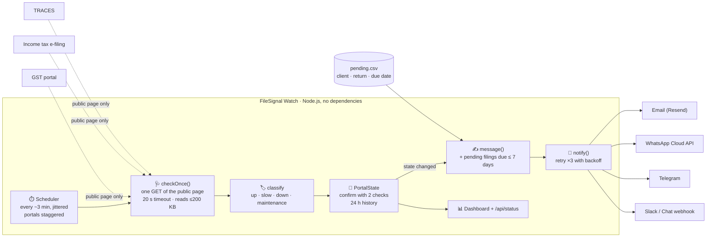
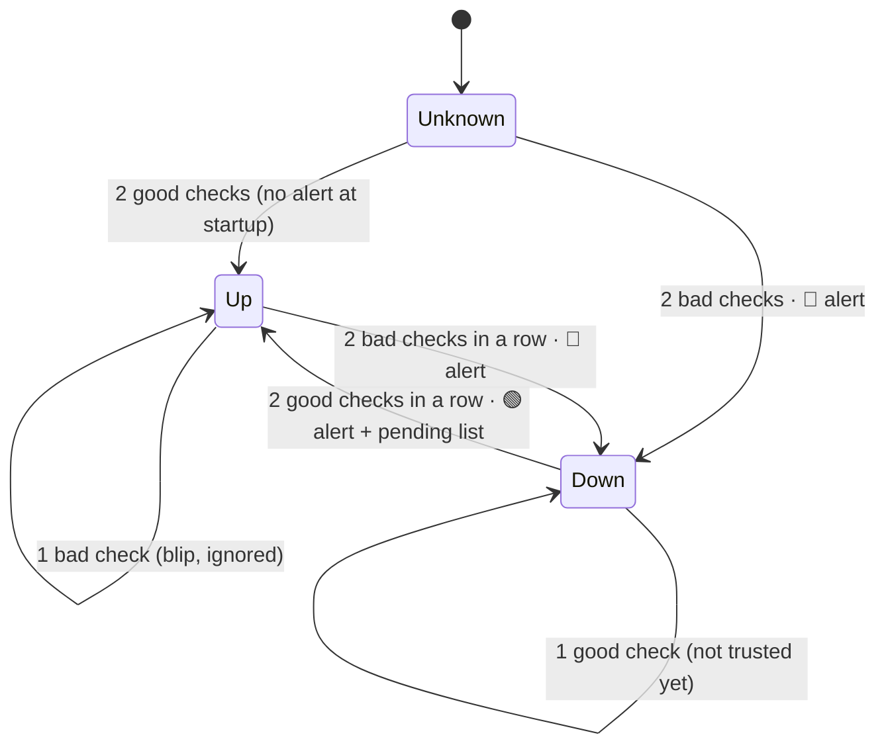

<div align="center">

# FileSignal Watch

**Know when to file.**

Watches the GST, income tax and TRACES portals and alerts the team the moment one is back up, with the list of clients ready to file.
No logins. No credentials. No captchas. No dependencies.

[](https://filesignal-watch.onrender.com)
[](https://filesignal.onrender.com)


</div>

---

## Contents

- [The problem](#the-problem)
- [What it does](#what-it-does)
- [Architecture](#architecture)
- [How it decides](#how-it-decides)
- [Alerts](#alerts)
- [Security and good behaviour](#security-and-good-behaviour)
- [Quick start](#quick-start)
- [Configuration](#configuration)
- [Project structure](#project-structure)
- [Testing](#testing)
- [Deployment](#deployment)
- [Roadmap](#roadmap)

---

## The problem

On deadline days, the government filing portals slow down or go offline. Someone on the team sits refreshing the page until it comes back, then files as fast as possible before it goes down again. Across 50+ clients, that's hours of waiting, and filings get missed.

## What it does

| | |
|---|---|
| 🩺 **Checks 4 portals** | GST (login and home), income tax e-filing, TRACES, about every 3 minutes |
| 🚦 **Up / Slow / Down / Maintenance** | Status from response codes, response time and maintenance pages |
| 🔔 **One alert per real change** | Two checks in a row must agree before an alert, so a blip sends nothing |
| 📋 **Pending filings in the alert** | "GST portal is back up after 1 h 35 min. 2 ready to file: …", sorted by due date |
| 📨 **Email, WhatsApp, Telegram, Slack** | Any combination; failed alerts retry 3 times |
| 📈 **Dashboard** | Live status, the last 24 hours of checks, and recent alerts exactly as sent |

## Architecture



## How it decides



| Check result | Counts as | Rule |
|---|---|---|
| HTTP 2xx/3xx in under 8 s | **Up** | |
| HTTP 2xx/3xx in over 8 s | **Slow** | Still usable, worth trying |
| Page says "under maintenance" etc. | **Maintenance** | Not usable |
| HTTP 5xx or 429, no answer in 20 s, can't connect | **Down** | Not usable |

## Alerts

Example recovery alert:

```
🟢 GST portal (login) is back up after 1 h 35 min (2.1s response). File now.
2 ready to file, 3 due within 7 days:
• Sunrise Foods Pvt Ltd: GSTR-3B Oct 2026 (due today, ready)
• Kaveri Textiles LLP: GSTR-3B Oct 2026 (due today, ready)
• Nimbus Labs Pvt Ltd: GSTR-3B Oct 2026 (due today, needs review)
```

Each alert only lists filings for **that** portal (GST returns for GST, TDS for TRACES), skips anything marked `filed`, and sorts by due date.

| Channel | Variables | Notes |
|---|---|---|
| Email | `RESEND_API_KEY`, `ALERT_EMAIL_FROM`, `ALERT_EMAIL_TO` | Easiest; comma-separate recipients |
| WhatsApp | `WHATSAPP_TOKEN`, `WHATSAPP_PHONE_ID`, `WHATSAPP_TO`, `WHATSAPP_TEMPLATE` | Meta's official Cloud API; business-initiated alerts need an approved template |
| Telegram | `TELEGRAM_BOT_TOKEN`, `TELEGRAM_CHAT_ID` | Free, 2-minute setup |
| Slack / Google Chat / Discord | `WEBHOOK_URL` | Incoming webhook |

## Security and good behaviour

| | |
|---|---|
| Never logs in | Loads only the public page, the same as opening it in a browser. No credentials, no captchas, no forms |
| Honest identity | Sends `User-Agent: FileSignalWatch/1.0 (uptime check)` instead of pretending to be a browser |
| Polite | At most one request per portal per minute (default about every 3 min, randomly spaced) |
| Secrets | Read only from environment variables, never logged. A test checks the Telegram token never reaches the logs |
| Dashboard | Read-only (GET only), strict CSP, no framing, no caching, optional password (`DASH_PASSWORD`) |
| HTTPS only | Portal URLs must be `https://` |
| No client data | The pending list holds only client names, return names and dates |

## Quick start

```bash
git clone https://github.com/punar4/filesignal-watch.git
cd filesignal-watch
npm test          # 6 tests against a fake portal, nothing to install
npm run once      # check all portals once and print the results
npm start         # watch continuously, dashboard on http://localhost:3100
```

```
$ npm run once
UP      729ms  GST portal (login)  Responding normally
UP      331ms  GST portal (home)  Responding normally
UP      381ms  Income tax e-filing  Responding normally
UP      461ms  TRACES (TDS)  Responding normally
```

## Configuration

| Variable | Default | Purpose |
|---|---|---|
| `INTERVAL_SEC` | 180 | Seconds between checks (minimum 60) |
| `SLOW_MS` | 8000 | Above this, a portal counts as slow |
| `PENDING_FILE` | `config/pending.csv` | Pending filings: `client,return,period,due_date,status` |
| `PORTALS_FILE` | `config/portals.json` | Portal names, URLs and the returns filed on each |
| `DASH_PASSWORD` | — | Puts the dashboard behind a password |
| `PORT` | 3100 | |

## Project structure

```
src/
  watch.js     checkOnce(), PortalState (hysteresis), pending list, alert text
  notify.js    email / WhatsApp / Telegram / webhook, with retry
  server.js    scheduler + dashboard + /api/status, --once mode
public/        dashboard (no inline scripts, strict CSP)
config/        portals.json, pending.sample.csv
test/          node:test suite with a fake portal
```

## Testing

```bash
npm test
```

| Test | What it proves |
|---|---|
| Classification | Up, slow, maintenance, server error and timeout are told apart (fake portal) |
| Hysteresis | One alert per real change; blips ignored; nothing sent at startup |
| Alert content | Only due filings for that portal, soonest first; filed ones skipped |
| Delivery | Failed alerts retry; secrets never appear in logs |
| Dashboard | Security headers, password, read-only, no path traversal |
| Channels | Email and WhatsApp requests are built correctly |

## Deployment

**Render:** New → Blueprint → pick this repo. [`render.yaml`](render.yaml) deploys it in Singapore (closest to the Indian portals). On the free plan, point a [cron-job.org](https://cron-job.org) job at `/health` every 10 minutes so it never sleeps.

**Docker:**

```bash
docker build -t filesignal-watch . && docker run -p 3100:3100 filesignal-watch
```

## Roadmap

- [x] Portal checks with hysteresis and 24 h history
- [x] Email, WhatsApp, Telegram and Slack alerts
- [x] Pending filings in every recovery alert
- [ ] Read the pending list straight from [FileSignal Ready](https://github.com/punar4/filesignal)
- [ ] Outage history: which hours are safest to file
- [ ] Help with mid-filing failures (session drops, submit errors)

---

<div align="center">

Built by **Punarnava** · Part of **FileSignal** · Know what's ready. Know when to file.

</div>
